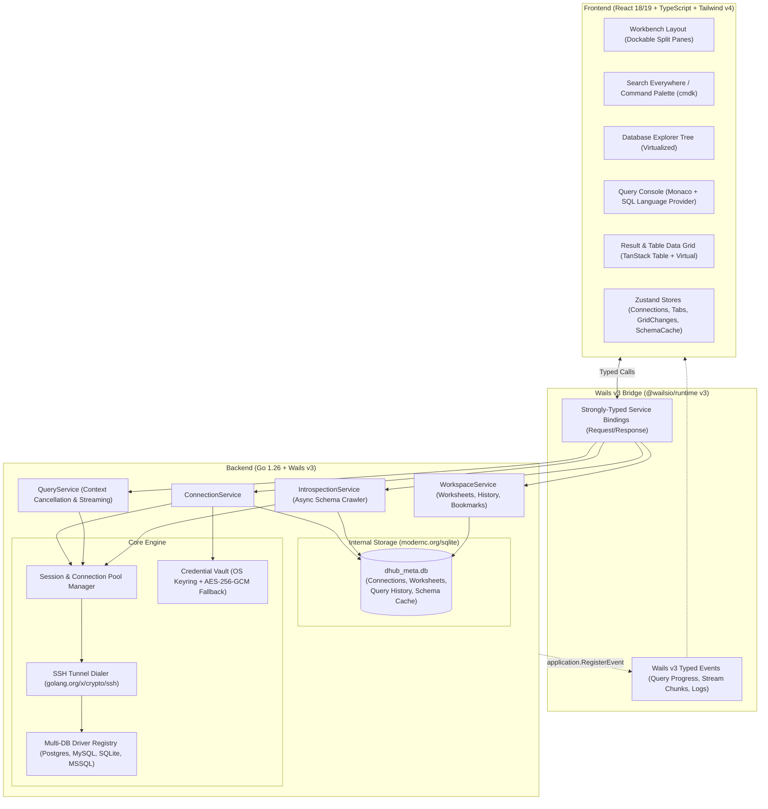

# DHub — Architectural Blueprint & Implementation Plan

> **DHub** adalah aplikasi desktop database client ultra-modern, ringan, *keyboard-first*, dan berkinerja tinggi yang terinspirasi dari **JetBrains DataGrip (New UI / Islands Theme)**—dibangun di atas **Go + Wails v3 (`wails3`)** dan **React + TypeScript + Tailwind CSS v4 + Shadcn UI + Monaco Editor**.

---

## 1. Visi & Prinsip Desain Utama

Menggantikan footprint memori besar dan waktu startup lambat berbasis JVM milik DataGrip dengan native Go concurrency dan webview modern:

1. **Zero-Lag & Low Footprint**: Startup `< 300ms`, idle RAM `< 80MB`, dan eksekusi query streaming/chunked melalui Go goroutines & Wails v3 Events.
2. **DataGrip-Inspired Ergonomics**:
   - **Database Explorer Tree** (kiri): Hirarki `Connection -> Database -> Schema -> Tables / Views / Routines -> Columns & Indexes` dengan *lazy introspection* dan *background caching*.
   - **Multi-Tab Query Console & Table Editor** (tengah): Worksheet SQL dengan Monaco Editor + *context-aware SQL autocomplete*, dilengkapi panel *Services / Output / Execution Plan* di bagian bawah yang dapat di-*split*.
   - **Transactional Inline Data Grid**: Edit sel langsung di tabel, tambah/hapus baris, *highlight* perubahan (hijau = insert, biru = update, abu/merah = delete), preview script `DML` (`UPDATE`/`INSERT`/`DELETE`), lalu **Submit (`Ctrl+Enter`)** atau **Rollback (`Ctrl+Alt+Z`)**.
   - **Keyboard-First Workflow**: Navigasi penuh tanpa mouse (`Shift+Shift` Search Everywhere, `Ctrl+Enter` Run QueryAtCursor, `Ctrl+N` Go to Table, `Ctrl+E` Recent Files/Worksheets, `Alt+1` Focus Database Tree).
3. **Multi-Database Extensibility**: Satu kontrak `Driver` di Go yang mendukung PostgreSQL, MySQL/MariaDB, SQLite, SQL Server, ClickHouse, dan Redis/MongoDB (ekspansi tahap lanjut), lengkap dengan **SSH Tunneling** dan **TLS/SSL** native di Go.

---

## 2. Arsitektur Sistem (High-Level Architecture)



### Aliran Eksekusi Query & Pembatalan (Query Lifecycle)
1. Pengguna menekan `Ctrl+Enter` pada blok SQL di Monaco Editor.
2. Frontend mendeteksi statement aktif di posisi kursor (atau teks yang diblok) dan memanggil `QueryService.Execute(req)` dengan `executionId` (UUID).
3. `QueryService` membuat `context.WithCancel(ctx)` dan menyimpannya di `activeQueries map[string]context.CancelFunc`.
4. Jika pengguna menekan tombol **Stop (`Ctrl+F2`)**, frontend memanggil `QueryService.Cancel(executionId)` yang langsung membatalkan context Go dan menghentikan query di sisi driver database.
5. Untuk hasil besar, baris dikirim per *page/chunk* atau diambil melalui *server-side cursor / pagination* (`LIMIT/OFFSET` otomatis jika belum ada), dilengkapi metrik waktu (`elapsedMs`, `fetchMs`, `rowsAffected`).

---

## 3. Struktur Folder Proyek

```text
dhub/
├── main.go                          # Entry point Wails v3, registrasi Services & Events
├── go.mod                           # Modul Go (github.com/wailsapp/wails/v3)
├── Taskfile.yml                     # Build & dev tasks untuk Wails v3
├── plan.md                          # Dokumen blueprint ini
│
├── internal/
│   ├── app/
│   │   └── events.go                # Definisi nama & payload Wails v3 Events
│   ├── config/
│   │   └── paths.go                 # Resolusi XDG path (~/.config/dhub, ~/.cache/dhub)
│   ├── crypto/
│   │   └── keyring.go               # Integrasi OS Keyring (zalando/go-keyring) & AES-GCM
│   ├── store/
│   │   ├── sqlite.go                # Koneksi SQLite internal (dhub.db) + migrasi
│   │   ├── connections_repo.go      # CRUD konfigurasi koneksi & folder grup
│   │   ├── worksheets_repo.go       # Penyimpanan file/tab SQL & query history
│   │   └── metadata_cache_repo.go   # Cache hasil introspeksi schema untuk autocomplete cepat
│   ├── tunnel/
│   │   └── ssh.go                   # Dialer SSH Tunnel (Password / Private Key / Agent)
│   ├── driver/
│   │   ├── driver.go                # Interface utama DatabaseDriver & tipe domain
│   │   ├── registry.go              # Factory & registrasi driver
│   │   ├── postgres/
│   │   │   └── postgres.go          # Implementasi pgx/v5 (introspection, explain, types)
│   │   ├── mysql/
│   │   │   └── mysql.go             # Implementasi go-sql-driver/mysql
│   │   └── sqlite/
│   │       └── sqlite.go            # Implementasi modernc.org/sqlite (CGO-free)
│   ├── manager/
│   │   └── session_manager.go       # Manajemen active pool, transaksi manual/auto-commit, ping
│   └── services/                    # Wails v3 Services (di-expose ke TypeScript)
│       ├── connection_service.go    # Test, Save, Connect, Disconnect, List Connections
│       ├── schema_service.go        # GetDatabases, GetSchemas, GetTables, GetTableDetail, Refresh
│       ├── query_service.go         # ExecuteQuery, CancelQuery, CommitChanges, ExplainQuery
│       └── workspace_service.go     # SaveWorksheet, ListWorksheets, GetQueryHistory
│
└── frontend/
    ├── package.json
    ├── vite.config.ts
    ├── tsconfig.json
    ├── bindings/                    # Auto-generated oleh `wails3 generate bindings`
    └── src/
        ├── main.tsx
        ├── App.tsx                  # Root Workbench (Titlebar, Sidebar, Editor Area, StatusBar)
        ├── styles/
        │   └── globals.css          # Tailwind CSS v4 (@import "tailwindcss") + variabel tema DataGrip
        ├── types/
        │   └── domain.ts            # Tipe data frontend (Tab, StagedChange, TreeNode, dll.)
        ├── stores/
        │   ├── useConnectionStore.ts # State koneksi aktif & tree explorer
        │   ├── useWorkbenchStore.ts  # State multi-tab (Console, Table Data, DDL), split pane, layout
        │   └── useGridEditStore.ts   # Buffer perubahan baris (Insert/Update/Delete) sebelum Submit
        ├── hooks/
        │   ├── useKeyboardShortcuts.ts # Global keymap bergaya JetBrains DataGrip
        │   └── useSqlCompletion.ts     # Registrasi schema-aware IntelliSense ke Monaco
        ├── components/
        │   ├── layout/
        │   │   ├── TitleBar.tsx        # Custom window bar + Quick Connection Switcher + Search Trigger
        │   │   ├── ActivityBar.tsx     # Strip ikon kiri/kanan (Database, Files, History, Bookmarks)
        │   │   ├── DatabaseExplorer.tsx# Tree view hirarkis dengan filter cepat (Speed Search)
        │   │   ├── ServicesPanel.tsx   # Panel bawah: Result Grid, Output Console, Execution Plan
        │   │   └── StatusBar.tsx       # Bar bawah: Tx mode (Auto/Manual), Active Schema, Memory, Latency
        │   ├── editor/
        │   │   ├── SqlWorksheet.tsx    # Monaco Editor + Gutter Run Button + Statement Detector
        │   │   └── DdlViewer.tsx       # Read-only DDL generator view
        │   ├── grid/
        │   │   ├── DataGrid.tsx        # Virtualized grid (@tanstack/react-table + @tanstack/react-virtual)
        │   │   ├── CellEditor.tsx      # Inline editor berdasarkan tipe kolom (JSON, Date, Bool, Text)
        │   │   └── DmlPreviewBar.tsx   # Preview bar untuk melihat query UPDATE/INSERT/DELETE yang di-stage
        │   └── modals/
        │       ├── ConnectionDialog.tsx # Modal Data Sources & Drivers (General, SSH, SSL, Options)
        │       └── SearchEverywhere.tsx # Modal `Shift+Shift` (Cari Tabel, Kolom, Action, Worksheet)
        └── lib/
            ├── sqlParser.ts            # Pemisah statement SQL pada posisi kursor & generator DML
            └── utils.ts
```

---

## 4. Skema Database Internal (SQLite `dhub_meta.db`)

DHub menggunakan SQLite murni Go (`modernc.org/sqlite`, tanpa dependensi CGO) untuk menyimpan konfigurasi lokal, tab worksheet, riwayat eksekusi, dan cache metadata agar autocomplete bekerja instan bahkan sebelum introspeksi ulang selesai.

> **Keamanan Kredensial**: Password database dan passphrase SSH **tidak** disimpan dalam teks biasa di SQLite. DHub menyimpannya di **OS Keyring** (`libsecret`/GNOME Keyring di Linux, Keychain di macOS, Credential Manager di Windows) dengan kunci `dhub:conn:<connection_id>`.

```sql
-- 1. Grup / Folder Koneksi
CREATE TABLE IF NOT EXISTS connection_folders (
    id          TEXT PRIMARY KEY,
    name        TEXT NOT NULL,
    parent_id   TEXT REFERENCES connection_folders(id) ON DELETE CASCADE,
    sort_order  INTEGER NOT NULL DEFAULT 0,
    created_at  DATETIME NOT NULL DEFAULT CURRENT_TIMESTAMP
);

-- 2. Konfigurasi Koneksi (Data Sources)
CREATE TABLE IF NOT EXISTS connections (
    id              TEXT PRIMARY KEY,
    folder_id       TEXT REFERENCES connection_folders(id) ON DELETE SET NULL,
    name            TEXT NOT NULL,
    driver          TEXT NOT NULL, -- 'postgres' | 'mysql' | 'sqlite' | 'mssql' | 'clickhouse'
    color_tag       TEXT NOT NULL DEFAULT '#3b82f6', -- Indikator lingkungan (Merah=Prod, Hijau=Dev, dll.)
    is_read_only     INTEGER NOT NULL DEFAULT 0,     -- Proteksi mode Read-Only di level aplikasi
    tx_mode         TEXT NOT NULL DEFAULT 'auto',    -- 'auto' | 'manual'
    host            TEXT NOT NULL DEFAULT 'localhost',
    port            INTEGER NOT NULL DEFAULT 5432,
    username        TEXT NOT NULL DEFAULT '',
    database_name   TEXT NOT NULL DEFAULT '',
    file_path       TEXT NOT NULL DEFAULT '',        -- Khusus SQLite / DuckDB
    ssl_mode        TEXT NOT NULL DEFAULT 'disable', -- 'disable' | 'require' | 'verify-ca' | 'verify-full'
    ssl_ca_path     TEXT NOT NULL DEFAULT '',
    ssl_cert_path   TEXT NOT NULL DEFAULT '',
    ssl_key_path    TEXT NOT NULL DEFAULT '',
    ssh_enabled     INTEGER NOT NULL DEFAULT 0,
    ssh_host        TEXT NOT NULL DEFAULT '',
    ssh_port        INTEGER NOT NULL DEFAULT 22,
    ssh_user        TEXT NOT NULL DEFAULT '',
    ssh_auth_type   TEXT NOT NULL DEFAULT 'key',     -- 'password' | 'key' | 'agent'
    ssh_key_path    TEXT NOT NULL DEFAULT '',
    options_json    TEXT NOT NULL DEFAULT '{}',      -- Parameter driver tambahan (timeout, search_path, dll.)
    sort_order      INTEGER NOT NULL DEFAULT 0,
    created_at      DATETIME NOT NULL DEFAULT CURRENT_TIMESTAMP,
    updated_at      DATETIME NOT NULL DEFAULT CURRENT_TIMESTAMP
);

-- 3. SQL Worksheets (Query Consoles yang tersimpan otomatis seperti DataGrip)
CREATE TABLE IF NOT EXISTS worksheets (
    id              TEXT PRIMARY KEY,
    connection_id   TEXT REFERENCES connections(id) ON DELETE CASCADE,
    title           TEXT NOT NULL,
    content         TEXT NOT NULL DEFAULT '',
    target_database TEXT NOT NULL DEFAULT '',
    target_schema   TEXT NOT NULL DEFAULT '',
    is_pinned       INTEGER NOT NULL DEFAULT 0,
    cursor_line     INTEGER NOT NULL DEFAULT 1,
    cursor_col      INTEGER NOT NULL DEFAULT 1,
    sort_order      INTEGER NOT NULL DEFAULT 0,
    updated_at      DATETIME NOT NULL DEFAULT CURRENT_TIMESTAMP
);

-- 4. Riwayat Eksekusi Query (Query Audit & History)
CREATE TABLE IF NOT EXISTS query_history (
    id              INTEGER PRIMARY KEY AUTOINCREMENT,
    connection_id   TEXT NOT NULL,
    database_name   TEXT NOT NULL DEFAULT '',
    schema_name     TEXT NOT NULL DEFAULT '',
    sql_text        TEXT NOT NULL,
    duration_ms     INTEGER NOT NULL DEFAULT 0,
    rows_affected   INTEGER NOT NULL DEFAULT 0,
    status          TEXT NOT NULL, -- 'success' | 'error' | 'cancelled'
    error_message   TEXT NOT NULL DEFAULT '',
    executed_at     DATETIME NOT NULL DEFAULT CURRENT_TIMESTAMP
);
CREATE INDEX IF NOT EXISTS idx_query_history_conn_time ON query_history(connection_id, executed_at DESC);

-- 5. Metadata Cache (Untuk Instant Startup & Search Everywhere `Shift+Shift`)
CREATE TABLE IF NOT EXISTS schema_cache (
    connection_id   TEXT NOT NULL,
    database_name   TEXT NOT NULL,
    schema_name     TEXT NOT NULL,
    object_type     TEXT NOT NULL, -- 'table' | 'view' | 'mat_view' | 'function'
    object_name     TEXT NOT NULL,
    columns_json    TEXT NOT NULL DEFAULT '[]', -- Array of {name, dataType, isNullable, isPrimaryKey, defaultVal}
    indexes_json    TEXT NOT NULL DEFAULT '[]',
    foreign_keys_json TEXT NOT NULL DEFAULT '[]',
    row_estimate    INTEGER NOT NULL DEFAULT 0,
    synced_at       DATETIME NOT NULL DEFAULT CURRENT_TIMESTAMP,
    PRIMARY KEY (connection_id, database_name, schema_name, object_type, object_name)
);
```

---

## 5. Kontrak Arsitektur Backend (Go + Wails v3)

### 5.1 Multi-Database Driver Interface (`internal/driver/driver.go`)

Semua engine database mengimplementasikan interface tunggal `DatabaseDriver` sehingga penambahan database baru tidak mengubah layer service maupun UI:

```go
package driver

import (
	"context"
)

type DriverType string

const (
	DriverPostgres DriverType = "postgres"
	DriverMySQL    DriverType = "mysql"
	DriverSQLite   DriverType = "sqlite"
)

type ColumnMeta struct {
	Name         string `json:"name"`
	DataType     string `json:"dataType"`     // e.g. "varchar(255)", "int8", "timestamptz"
	RawType      string `json:"rawType"`      // Tipe dasar untuk editor sel
	IsNullable   bool   `json:"isNullable"`
	IsPrimaryKey bool   `json:"isPrimaryKey"`
	IsAutoIncr   bool   `json:"isAutoIncrement"`
	DefaultValue string `json:"defaultValue"`
	Comment      string `json:"comment"`
}

type ForeignKeyMeta struct {
	ConstraintName string `json:"constraintName"`
	ColumnName     string `json:"columnName"`
	RefSchema      string `json:"refSchema"`
	RefTable       string `json:"refTable"`
	RefColumn      string `json:"refColumn"`
	OnUpdate       string `json:"onUpdate"`
	OnDelete       string `json:"onDelete"`
}

type IndexMeta struct {
	Name      string   `json:"name"`
	Columns   []string `json:"columns"`
	IsUnique  bool     `json:"isUnique"`
	IsPrimary bool     `json:"isPrimary"`
}

type ObjectSummary struct {
	Schema      string `json:"schema"`
	Name        string `json:"name"`
	Type        string `json:"type"` // "table" | "view" | "materialized_view" | "routine"
	RowEstimate int64  `json:"rowEstimate"`
	SizePretty  string `json:"sizePretty"`
	Comment     string `json:"comment"`
}

type TableStructure struct {
	Schema      string           `json:"schema"`
	Name        string           `json:"name"`
	Columns     []ColumnMeta     `json:"columns"`
	PrimaryKeys []string         `json:"primaryKeys"`
	ForeignKeys []ForeignKeyMeta `json:"foreignKeys"`
	Indexes     []IndexMeta      `json:"indexes"`
	DDL         string           `json:"ddl"`
}

type QueryRequest struct {
	ExecutionID string `json:"executionId"`
	ConnectionID string `json:"connectionId"`
	Database    string `json:"database"`
	Schema      string `json:"schema"`
	SQL         string `json:"sql"`
	Limit       int    `json:"limit"`
	Offset      int    `json:"offset"`
}

type QueryResult struct {
	ExecutionID  string           `json:"executionId"`
	Columns      []ColumnMeta     `json:"columns"`
	Rows         [][]any          `json:"rows"`
	RowsAffected int64            `json:"rowsAffected"`
	ElapsedMs    int64            `json:"elapsedMs"`
	HasMore      bool             `json:"hasMore"`
	IsEditable   bool             `json:"isEditable"`
	SourceSchema string           `json:"sourceSchema"`
	SourceTable  string           `json:"sourceTable"`
	PrimaryKeys  []string         `json:"primaryKeys"`
	Error        string           `json:"error,omitempty"`
}

type RowChange struct {
	Type       string         `json:"type"` // "insert" | "update" | "delete"
	PrimaryKey map[string]any `json:"primaryKey"`
	Changes    map[string]any `json:"changes"`
}

type DatabaseDriver interface {
	Ping(ctx context.Context) error
	Close() error

	// Introspection
	ListDatabases(ctx context.Context) ([]string, error)
	ListSchemas(ctx context.Context, database string) ([]string, error)
	ListObjects(ctx context.Context, database, schema string) ([]ObjectSummary, error)
	GetTableStructure(ctx context.Context, database, schema, table string) (*TableStructure, error)

	// Execution & Editing
	Execute(ctx context.Context, req QueryRequest) (*QueryResult, error)
	ApplyChanges(ctx context.Context, schema, table string, changes []RowChange) (int64, error)
	GenerateDMLPreview(schema, table string, changes []RowChange) ([]string, error)
}
```

### 5.2 Starter Code Backend: `main.go` (Wails v3)

Pada Wails v3, kita mendaftarkan `Services` menggunakan `application.NewService(...)` dan mendaftarkan custom event bertipe kuat dengan `application.RegisterEvent[T](...)`.

```go
package main

import (
	"embed"
	"log"

	"changeme/internal/app"
	"changeme/internal/manager"
	"changeme/internal/services"
	"changeme/internal/store"

	"github.com/wailsapp/wails/v3/pkg/application"
)

//go:embed all:frontend/dist
var assets embed.FS

func init() {
	// Registrasi Strongly-Typed Events untuk Wails v3 binding generator
	application.RegisterEvent[app.QueryStatusEvent]("query:status")
	application.RegisterEvent[app.SchemaSyncEvent]("schema:sync")
	application.RegisterEvent[app.ConnectionStateEvent]("connection:state")
}

func main() {
	localStore, err := store.NewLocalStore()
	if err != nil {
		log.Fatalf("failed to initialize internal sqlite store: %v", err)
	}
	defer localStore.Close()

	sessionMgr := manager.NewSessionManager(localStore)

	var wailsApp *application.App

	connSvc := services.NewConnectionService(localStore, sessionMgr, func() *application.App { return wailsApp })
	schemaSvc := services.NewSchemaService(localStore, sessionMgr, func() *application.App { return wailsApp })
	querySvc := services.NewQueryService(localStore, sessionMgr, func() *application.App { return wailsApp })
	workspaceSvc := services.NewWorkspaceService(localStore)

	wailsApp = application.New(application.Options{
		Name:        "DHub",
		Description: "High-Performance Multi-Database IDE",
		Services: []application.Service{
			application.NewService(connSvc),
			application.NewService(schemaSvc),
			application.NewService(querySvc),
			application.NewService(workspaceSvc),
		},
		Assets: application.AssetOptions{
			Handler: application.AssetFileServerFS(assets),
		},
		Mac: application.MacOptions{
			ApplicationShouldTerminateAfterLastWindowClosed: true,
		},
	})

	wailsApp.Window.NewWithOptions(application.WebviewWindowOptions{
		Title:            "DHub",
		Width:            1440,
		Height:           900,
		MinWidth:         1024,
		MinHeight:        640,
		BackgroundColour: application.NewRGB(18, 19, 23), // DataGrip Islands Dark Background
		URL:              "/",
	})

	if err := wailsApp.Run(); err != nil {
		log.Fatal(err)
	}
}
```

### 5.3 Starter Code Backend: `QueryService` dengan Context Cancellation & Transactional Edit

```go
package services

import (
	"context"
	"fmt"
	"sync"
	"time"

	"changeme/internal/app"
	"changeme/internal/driver"
	"changeme/internal/manager"
	"changeme/internal/store"

	"github.com/wailsapp/wails/v3/pkg/application"
)

type QueryService struct {
	store      *store.LocalStore
	sessions   *manager.SessionManager
	appGetter  func() *application.App
	mu         sync.Mutex
	runningOps map[string]context.CancelFunc
}

func NewQueryService(s *store.LocalStore, sm *manager.SessionManager, appGetter func() *application.App) *QueryService {
	return &QueryService{
		store:      s,
		sessions:   sm,
		appGetter:  appGetter,
		runningOps: make(map[string]context.CancelFunc),
	}
}

func (q *QueryService) ExecuteQuery(req driver.QueryRequest) (*driver.QueryResult, error) {
	drv, err := q.sessions.GetOrConnect(context.Background(), req.ConnectionID)
	if err != nil {
		return nil, err
	}

	ctx, cancel := context.WithTimeout(context.Background(), 5*time.Minute)
	q.mu.Lock()
	q.runningOps[req.ExecutionID] = cancel
	q.mu.Unlock()

	defer func() {
		q.mu.Lock()
		delete(q.runningOps, req.ExecutionID)
		q.mu.Unlock()
		cancel()
	}()

	q.emitStatus(req.ExecutionID, "running", "Executing statement...")
	start := time.Now()

	res, execErr := drv.Execute(ctx, req)
	elapsed := time.Since(start).Milliseconds()

	status := "success"
	errMsg := ""
	var rowsAffected int64
	if execErr != nil {
		status = "error"
		errMsg = execErr.Error()
		q.emitStatus(req.ExecutionID, "error", errMsg)
	} else if res != nil {
		res.ElapsedMs = elapsed
		rowsAffected = res.RowsAffected
		q.emitStatus(req.ExecutionID, "completed", fmt.Sprintf("Fetched %d rows in %dms", len(res.Rows), elapsed))
	}

	_ = q.store.RecordQueryHistory(store.QueryHistoryEntry{
		ConnectionID: req.ConnectionID,
		DatabaseName: req.Database,
		SchemaName:   req.Schema,
		SQLText:      req.SQL,
		DurationMs:   elapsed,
		RowsAffected: rowsAffected,
		Status:       status,
		ErrorMessage: errMsg,
	})

	return res, execErr
}

func (q *QueryService) CancelQuery(executionID string) bool {
	q.mu.Lock()
	cancel, exists := q.runningOps[executionID]
	q.mu.Unlock()
	if exists {
		cancel()
		q.emitStatus(executionID, "cancelled", "Query cancelled by user")
		return true
	}
	return false
}

func (q *QueryService) PreviewChanges(connectionID, schema, table string, changes []driver.RowChange) ([]string, error) {
	drv, err := q.sessions.GetOrConnect(context.Background(), connectionID)
	if err != nil {
		return nil, err
	}
	return drv.GenerateDMLPreview(schema, table, changes)
}

func (q *QueryService) SubmitChanges(connectionID, schema, table string, changes []driver.RowChange) (int64, error) {
	drv, err := q.sessions.GetOrConnect(context.Background(), connectionID)
	if err != nil {
		return 0, err
	}
	ctx, cancel := context.WithTimeout(context.Background(), 30*time.Second)
	defer cancel()
	return drv.ApplyChanges(ctx, schema, table, changes)
}

func (q *QueryService) emitStatus(execID, state, message string) {
	if a := q.appGetter(); a != nil {
		a.Event.Emit("query:status", app.QueryStatusEvent{
			ExecutionID: execID,
			State:       state,
			Message:     message,
			Timestamp:   time.Now().UnixMilli(),
		})
	}
}
```

---

## 6. Desain UI/UX & Frontend Architecture (DataGrip New UI)

### 6.1 Tata Letak Workbench ("Islands Dark UI")

```text
+--------------------------------------------------------------------------------------------------+
| [DB Icon] DHub   [Prod-PG v] [public v]  [ > Run (Ctrl+Enter) ] [ || Stop ]   [Search (Shift x2)] |
+---+------------------------+---------------------------------------------------------------------+
|   | DATABASE EXPLORER      | [console_1.sql *] [users (Table)] [orders (Table)] [DDL: users]     |
| [D] Filter tables...       +---------------------------------------------------------------------+
| [F] v [Prod] Main Postgres | 1 | -- Tekan Ctrl+Enter untuk menjalankan query di kursor           |
| [H]   v postgres           | 2 | SELECT u.id, u.email, u.role, u.created_at                      |
|         v public           | 3 | FROM public.users u                                             |
|           > tables (42)    | 4 | WHERE u.is_active = true                                        |
|             # users        | 5 | ORDER BY u.created_at DESC;                                     |
|             # orders       | 6 |                                                                 |
|             # invoices     +---------------------------------------------------------------------+
|           > views (8)      | SERVICES / RESULT  [Result 1 (240 rows)] [Output] [Explain Plan]    |
|           > routines (12)  +---------------------------------------------------------------------+
|     > [Local] SQLite App   | [+] [-] [Revert] [DML Preview] [Submit (2 changes)] | WHERE [id > 10]|
|                            |---------------------------------------------------------------------|
|                            | #  | id (PK) | email               | role        | created_at       |
|                            |----+---------+---------------------+-------------+------------------|
|                            | 1  | 101     | alice@company.io    | superadmin* | 2026-10-29 09:00 | <- Edited (Blue)
|                            | 2  | 102     | bob@company.io      | engineer    | 2026-10-29 09:15 |
|                            | 3* | <auto>  | new@company.io      | viewer      | DEFAULT          | <- Inserted (Green)
+---+------------------------+---------------------------------------------------------------------+
| [*] Connected: Prod-PG (PostgreSQL 17.1) | Tx: AUTO | Latency: 4ms | Rows: 1-240 | 14 ms         |
+--------------------------------------------------------------------------------------------------+
```

### 6.2 Sistem Palet Warna & Tipografi (Tailwind CSS v4)
- **Canvas Background (Outer Shell)**: `#121317`
- **Island Panel Background (Tree / Editor / Grid)**: `#191a20` dengan `border: 1px solid #272932` dan `border-radius: 8px` (khas JetBrains Islands UI)
- **Active Selection / Focus Ring**: `#3574f0`
- **Diff / Staging Highlight di Data Grid**:
  - **Inserted Row**: `bg-emerald-500/15 border-l-2 border-emerald-400`
  - **Modified Cell**: `bg-blue-500/20 text-blue-200 ring-1 ring-blue-400/50`
  - **Deleted Row**: `bg-rose-500/15 line-through text-zinc-500`
- **Font**:
  - UI: `Inter` / `Plus Jakarta Sans` (`12px`–`13px` padat dan tajam)
  - Code & Data Grid: `JetBrains Mono` (`12.5px`, `font-variant-numeric: tabular-nums`)

### 6.3 Peta Pintasan Keyboard (Keymap DataGrip)

| Pintasan | Aksi di DHub |
| :--- | :--- |
| `Ctrl+Enter` / `Cmd+Enter` | Jalankan statement SQL di kursor **atau** Submit perubahan yang di-stage pada Table Grid |
| `Shift+Shift` (Double Shift) | Buka **Search Everywhere** (Tabel, View, Kolom, Koneksi, Worksheet, Action) |
| `Ctrl+Shift+F10` / `Ctrl+N` | Buka Quick Jump ke Tabel atau Buat Query Console baru |
| `Ctrl+Alt+L` | Format & Rapikan SQL di Monaco Editor |
| `Ctrl+Y` / `Cmd+Backspace` | Tandai baris terpilih untuk dihapus (Stage Delete) pada Data Grid |
| `Ctrl+D` / `Cmd+D` | Duplikasi baris terpilih pada Data Grid (Stage Insert) |
| `Ctrl+Alt+Z` | Revert / Batalkan perubahan sel atau baris yang di-stage |
| `Ctrl+F2` | Hentikan eksekusi query yang sedang berjalan (`CancelQuery`) |
| `Alt+1` | Toggle / Fokus ke panel **Database Explorer** |
| `Alt+4` | Toggle / Fokus ke panel **Services / Query Result** |

---

## 7. Starter Code Frontend (React + TypeScript)

### 7.1 State Management: `frontend/src/stores/useGridEditStore.ts`
Mengelola perubahan *in-memory* pada tabel sebelum di-commit ke database, termasuk pembuatan preview SQL secara real-time:

```typescript
import { create } from 'zustand';

export interface StagedRowChange {
  type: 'insert' | 'update' | 'delete';
  rowIndex: number;
  primaryKey: Record<string, unknown>;
  originalRow: Record<string, unknown>;
  changes: Record<string, unknown>;
}

interface GridEditState {
  // Keyed oleh tabId
  stagedByTab: Record<string, Record<number, StagedRowChange>>;
  stageCellUpdate: (
    tabId: string,
    rowIndex: number,
    primaryKey: Record<string, unknown>,
    originalRow: Record<string, unknown>,
    column: string,
    newValue: unknown
  ) => void;
  stageRowInsert: (tabId: string, tempRowIndex: number, initialValues?: Record<string, unknown>) => void;
  stageRowDelete: (tabId: string, rowIndex: number, primaryKey: Record<string, unknown>, originalRow: Record<string, unknown>) => void;
  revertTabChanges: (tabId: string) => void;
  getTabChangeCount: (tabId: string) => number;
}

export const useGridEditStore = create<GridEditState>((set, get) => ({
  stagedByTab: {},

  stageCellUpdate: (tabId, rowIndex, primaryKey, originalRow, column, newValue) =>
    set((state) => {
      const tabChanges = { ...(state.stagedByTab[tabId] || {}) };
      const existing = tabChanges[rowIndex];

      if (existing?.type === 'insert') {
        tabChanges[rowIndex] = {
          ...existing,
          changes: { ...existing.changes, [column]: newValue },
        };
      } else {
        const updatedChanges = { ...(existing?.changes || {}), [column]: newValue };
        if (originalRow[column] === newValue) {
          delete updatedChanges[column];
        }
        if (Object.keys(updatedChanges).length === 0) {
          delete tabChanges[rowIndex];
        } else {
          tabChanges[rowIndex] = {
            type: 'update',
            rowIndex,
            primaryKey,
            originalRow,
            changes: updatedChanges,
          };
        }
      }
      return { stagedByTab: { ...state.stagedByTab, [tabId]: tabChanges } };
    }),

  stageRowInsert: (tabId, tempRowIndex, initialValues = {}) =>
    set((state) => {
      const tabChanges = { ...(state.stagedByTab[tabId] || {}) };
      tabChanges[tempRowIndex] = {
        type: 'insert',
        rowIndex: tempRowIndex,
        primaryKey: {},
        originalRow: {},
        changes: initialValues,
      };
      return { stagedByTab: { ...state.stagedByTab, [tabId]: tabChanges } };
    }),

  stageRowDelete: (tabId, rowIndex, primaryKey, originalRow) =>
    set((state) => {
      const tabChanges = { ...(state.stagedByTab[tabId] || {}) };
      if (tabChanges[rowIndex]?.type === 'insert') {
        delete tabChanges[rowIndex];
      } else if (tabChanges[rowIndex]?.type === 'delete') {
        delete tabChanges[rowIndex]; // Toggle batal hapus
      } else {
        tabChanges[rowIndex] = {
          type: 'delete',
          rowIndex,
          primaryKey,
          originalRow,
          changes: {},
        };
      }
      return { stagedByTab: { ...state.stagedByTab, [tabId]: tabChanges } };
    }),

  revertTabChanges: (tabId) =>
    set((state) => {
      const next = { ...state.stagedByTab };
      delete next[tabId];
      return { stagedByTab: next };
    }),

  getTabChangeCount: (tabId) => Object.keys(get().stagedByTab[tabId] || {}).length,
}));
```

### 7.2 Monaco SQL Editor dengan Schema-Aware Autocomplete & Statement Detection (`SqlWorksheet.tsx`)

```tsx
import React, { useRef, useCallback } from 'react';
import Editor, { OnMount } from '@monaco-editor/react';
import type * as Monaco from 'monaco-editor';
import { Play, Square, Sparkles, Database } from 'lucide-react';

interface SqlWorksheetProps {
  tabId: string;
  connectionId: string;
  database: string;
  schema: string;
  sql: string;
  isRunning: boolean;
  schemaMetadata: Array<{ table: string; columns: Array<{ name: string; dataType: string }> }>;
  onChange: (value: string) => void;
  onExecute: (statementSql: string) => void;
  onCancel: () => void;
}

export const SqlWorksheet: React.FC<SqlWorksheetProps> = ({
  sql,
  database,
  schema,
  isRunning,
  schemaMetadata,
  onChange,
  onExecute,
  onCancel,
}) => {
  const editorRef = useRef<Monaco.editor.IStandaloneCodeEditor | null>(null);

  const extractActiveStatement = useCallback((): string => {
    const editor = editorRef.current;
    if (!editor) return sql;

    const selection = editor.getSelection();
    if (selection && !selection.isEmpty()) {
      return editor.getModel()?.getValueInRange(selection) || sql;
    }

    // Jika tidak ada blok teks, ambil statement SQL yang berada di posisi kursor (dipisahkan oleh `;`)
    const model = editor.getModel();
    const pos = editor.getPosition();
    if (!model || !pos) return sql;

    const fullText = model.getValue();
    const offset = model.getOffsetAt(pos);

    const before = fullText.lastIndexOf(';', Math.max(0, offset - 1));
    const after = fullText.indexOf(';', offset);

    const startIdx = before === -1 ? 0 : before + 1;
    const endIdx = after === -1 ? fullText.length : after;

    const candidate = fullText.slice(startIdx, endIdx).trim();
    return candidate || fullText.trim();
  }, [sql]);

  const handleEditorDidMount: OnMount = (editor, monaco) => {
    editorRef.current = editor;

    // Shortcut Ctrl+Enter / Cmd+Enter untuk menjalankan query di kursor
    editor.addCommand(monaco.KeyMod.CtrlCmd | monaco.KeyCode.Enter, () => {
      const stmt = extractActiveStatement();
      if (stmt) onExecute(stmt);
    });

    // Registrasi Schema-Aware Completion Provider
    monaco.languages.registerCompletionItemProvider('sql', {
      triggerCharacters: ['.', ' '],
      provideCompletionItems: (model, position) => {
        const word = model.getWordUntilPosition(position);
        const range = {
          startLineNumber: position.lineNumber,
          endLineNumber: position.lineNumber,
          startColumn: word.startColumn,
          endColumn: word.endColumn,
        };

        const suggestions: Monaco.languages.CompletionItem[] = [];

        for (const item of schemaMetadata) {
          suggestions.push({
            label: item.table,
            kind: monaco.languages.CompletionItemKind.Struct,
            detail: `Table (${schema})`,
            insertText: item.table,
            range,
          });

          for (const col of item.columns) {
            suggestions.push({
              label: `${col.name}`,
              kind: monaco.languages.CompletionItemKind.Field,
              detail: `${item.table}.${col.name} : ${col.dataType}`,
              insertText: col.name,
              range,
            });
          }
        }

        return { suggestions };
      },
    });
  };

  return (
    <div className="flex h-full flex-col bg-[#191a20]">
      {/* Toolbar Worksheet */}
      <div className="flex h-9 items-center justify-between border-b border-[#272932] px-3 text-xs">
        <div className="flex items-center gap-2">
          {!isRunning ? (
            <button
              onClick={() => onExecute(extractActiveStatement())}
              className="flex items-center gap-1.5 rounded bg-emerald-600/90 px-2.5 py-1 font-medium text-white hover:bg-emerald-500 transition-colors"
              title="Execute Statement (Ctrl+Enter)"
            >
              <Play className="h-3.5 w-3.5 fill-current" />
              <span>Run</span>
            </button>
          ) : (
            <button
              onClick={onCancel}
              className="flex items-center gap-1.5 rounded bg-rose-600/90 px-2.5 py-1 font-medium text-white hover:bg-rose-500 transition-colors"
              title="Stop Execution (Ctrl+F2)"
            >
              <Square className="h-3.5 w-3.5 fill-current" />
              <span>Stop</span>
            </button>
          )}

          <div className="h-4 w-[1px] bg-[#272932] mx-1" />

          <div className="flex items-center gap-1.5 rounded bg-[#22242c] px-2 py-1 text-zinc-300">
            <Database className="h-3.5 w-3.5 text-blue-400" />
            <span>{database || 'default'}</span>
            <span className="text-zinc-600">/</span>
            <span className="text-amber-300">{schema || 'public'}</span>
          </div>
        </div>

        <div className="flex items-center gap-2 text-zinc-400">
          <span className="text-[11px] text-zinc-500">Ctrl+Enter to Run at Cursor</span>
        </div>
      </div>

      {/* Area Monaco Editor */}
      <div className="flex-1 min-h-0">
        <Editor
          height="100%"
          defaultLanguage="sql"
          theme="vs-dark"
          value={sql}
          onChange={(v) => onChange(v ?? '')}
          onMount={handleEditorDidMount}
          options={{
            fontFamily: "'JetBrains Mono', monospace",
            fontSize: 13,
            lineHeight: 20,
            minimap: { enabled: false },
            padding: { top: 10, bottom: 10 },
            scrollBeyondLastLine: false,
            smoothScrolling: true,
            cursorBlinking: 'smooth',
            renderLineHighlight: 'all',
            automaticLayout: true,
          }}
        />
      </div>
    </div>
  );
};
```

---

## 8. Paket & Dependensi yang Direkomendasikan

### 8.1 Backend (`go.mod`)
| Paket | Kegunaan |
| :--- | :--- |
| `github.com/wailsapp/wails/v3` | Framework aplikasi desktop Wails v3 (Services, Multi-Window, Typed Events) |
| `github.com/jackc/pgx/v5` | Driver PostgreSQL performa tinggi + dukungan tipe native PG |
| `github.com/go-sql-driver/mysql` | Driver MySQL & MariaDB |
| `modernc.org/sqlite` | Driver SQLite murni Go (tanpa CGO) untuk database internal DHub & file SQLite user |
| `golang.org/x/crypto/ssh` | Implementasi SSH Tunneling terintegrasi tanpa bergantung pada binary eksternal |
| `github.com/zalando/go-keyring` | Penyimpanan password aman di OS Keyring (Linux Secret Service, macOS Keychain, Windows CredMan) |
| `github.com/google/uuid` | Pembuatan ID unik untuk koneksi, worksheet, dan `executionId` |

### 8.2 Frontend (`frontend/package.json`)
| Paket | Kegunaan |
| :--- | :--- |
| `@wailsio/runtime` (`3.0.0`) | Runtime resmi Wails v3 untuk event listener dan window control |
| `tailwindcss` (`^4.0.0`) + `@tailwindcss/vite` | Engine styling Tailwind CSS v4 zero-config |
| `@monaco-editor/react` + `monaco-editor` | Editor kode SQL kelas IDE |
| `@tanstack/react-table` + `@tanstack/react-virtual` | Data grid yang mampu me-render 100.000+ baris pada 60fps |
| `react-resizable-panels` | Split pane dapat di-resize (Explorer <-> Editor <-> Result Panel) |
| `zustand` | State management ringan dan cepat untuk tab, tree, dan staging transaksi |
| `cmdk` | Komponen **Search Everywhere (`Shift+Shift`)** & Command Palette |
| `lucide-react` | Ikon tajam untuk objek database (Tabel, PK, FK, Index, View, Trigger) |
| `framer-motion` | Transisi halus untuk modal, toast, dan *island* animasi |

---

## 9. Roadmap Implementasi Bertahap (Step-by-Step Execution Plan)

### Fase 1: Fondasi & Internal Storage (Milestone 1)
1. Rapikan nama modul Go di `go.mod` (misal `dhub`) dan instal dependensi Go (`modernc.org/sqlite`, `pgx/v5`, `go-sql-driver/mysql`, `uuid`, `go-keyring`).
2. Bangun `internal/store/sqlite.go` beserta migrasi otomatis untuk tabel `connections`, `worksheets`, `query_history`, dan `schema_cache`.
3. Implementasikan `internal/crypto/keyring.go` untuk enkripsi/penyimpanan password koneksi.

### Fase 2: Multi-Database Driver Engine & Wails v3 Services (Milestone 2)
1. Implementasikan kontrak `internal/driver/driver.go` beserta driver konkret pertama:
   - **PostgreSQL (`pgx/v5`)**: Introspeksi penuh (`pg_catalog` untuk tabel, kolom, PK, FK, index, estimasi baris, dan ukuran tabel).
   - **SQLite (`modernc.org/sqlite`)**: Introspeksi via `pragma_table_info`, `pragma_index_list`, dan `pragma_foreign_key_list`.
   - **MySQL (`go-sql-driver/mysql`)**: Introspeksi via `information_schema`.
2. Implementasikan `SessionManager` dengan dukungan SSH Tunnel (`internal/tunnel/ssh.go`) dan manajemen koneksi aktif.
3. Daftarkan `ConnectionService`, `SchemaService`, `QueryService`, dan `WorkspaceService` di `main.go`, lalu jalankan `wails3 generate bindings` untuk menghasilkan TypeScript bindings di `frontend/bindings/`.

### Fase 3: DataGrip "Islands" Workbench UI & Database Explorer (Milestone 3)
1. Setup **Tailwind CSS v4**, `lucide-react`, `zustand`, dan `react-resizable-panels` di `frontend/`.
2. Bangun layout **Islands Dark UI**:
   - `TitleBar` dengan indikator warna koneksi (Production = Merah, Staging = Kuning, Local = Hijau).
   - `DatabaseExplorer` dengan tree hirarkis, *lazy loading* per schema, ikon khusus untuk kolom `PK`/`FK`, dan fitur *Speed Search* saat mengetik di tree.
   - `ConnectionDialog` untuk menambah/menguji koneksi beserta tab SSH & SSL.

### Fase 4: SQL Console & Transactional Data Grid (Milestone 4)
1. Integrasikan `SqlWorksheet` berbasis Monaco Editor dengan fitur:
   - Deteksi statement SQL aktif pada posisi kursor (highlight blok query yang akan dijalankan).
   - Schema-aware autocomplete dari `schema_cache`.
2. Bangun `DataGrid` ter-virtualisasi dengan fitur:
   - Sorting klik header, filter bar cepat `WHERE ...` & `ORDER BY ...` seperti di DataGrip.
   - Inline cell editing (`Double Click` atau `Enter`), `Stage Insert`, `Stage Delete`.
   - Panel **DML Preview** (`UPDATE "public"."users" SET ... WHERE "id" = 101;`) dan tombol **Submit (`Ctrl+Enter`)** / **Revert (`Ctrl+Alt+Z`)**.

### Fase 5: Search Everywhere (`Shift+Shift`), Explain Plan, & Export/Import (Milestone 5)
1. Bangun modal **Search Everywhere** yang mencari lintas koneksi, tabel, kolom, dan riwayat query dalam `< 10ms` menggunakan indeks `schema_cache`.
2. Tambahkan eksportir hasil query ke **CSV, JSON, SQL Insert Statements, dan Markdown Table**.
3. Tambahkan visualisasi **Explain Plan** (`EXPLAIN (ANALYZE, COSTS, VERBOSE, BUFFERS, FORMAT JSON)` untuk PostgreSQL).


---

## 10. Roadmap Lanjutan: Perbaikan Kekurangan & Fitur Baru (Fase 6–10)

> Fase 1–5 di atas sudah terealisasi pada kode saat ini. Bagian ini adalah hasil audit kode dan berisi tahapan untuk menutup kekurangan serta menambah fitur. Estimasi: **S** (<1 hari), **M** (1–3 hari), **L** (3–7 hari). Centang `[x]` saat selesai.

### Aturan Umum Tiap Fase
- Kerjakan di branch terpisah per fase (`feat/fase-6-...`).
- Setiap ada perubahan method/struct pada service Go, jalankan `wails3 generate bindings` agar `frontend/bindings` sinkron.
- Tulis test bersamaan dengan fitur; jalankan `go test ./...` dan `npm run build` (di `frontend/`) sebelum merge.

---

### Fase 6: Persiapan & Perbaikan Bug Kritis Backend (Milestone 6)

**6.0 Persiapan (S)**
- [x] Siapkan `docker-compose.yml` untuk PostgreSQL & MySQL lokal (testing integrasi) dan fixture SQLite.
- [x] Ganti `README.md` bawaan template Wails dengan dokumentasi DHub (dev, build, fitur).

**6.1 Multi-database PostgreSQL (L)** — `internal/driver/postgres/postgres.go`, `internal/manager/session_manager.go`
- [x] Simpan pool per database (`map[string]*sql.DB`, dibuat lazy dengan path database berbeda pada connection string).
- [x] Gunakan parameter `database` di `ListSchemas`, `ListObjects`, `GetTableStructure`, `Execute` (saat ini diabaikan).
- [x] `ApplyChanges` & `GenerateDMLPreview` membawa parameter `database`: interface `DatabaseDriver`, driver PostgreSQL routing transaction ke `p.dbFor(database)`, driver MySQL & SQLite, `QueryService.SubmitChanges/PreviewChanges`, bindings TypeScript, dan pemanggil di `App.tsx`.
- [x] `Close()` menutup semua pool; SSH tunnel dipakai bersama oleh semua pool.
- [x] Test: routing pool per database (`postgres_test.go`). Test integrasi dengan server nyata: belum dijalankan.

**6.2 Metadata struktur tabel lengkap (M)**
- [x] PostgreSQL: indexes, auto-increment (serial/identity), komentar kolom & tabel, `onUpdate/onDelete` FK; lengkapi DDL.
- [x] MySQL: foreign keys (`key_column_usage` + `referential_constraints`).
- [x] SQLite: indexes (`PRAGMA index_list` + `index_info`), deteksi autoincrement.
- [x] Unit test: SQLite (index, FK, autoincrement) dan DDL PostgreSQL. Test MySQL/PG terhadap server nyata: belum.

**6.3 Pagination efisien (M)** — `internal/driver/executor.go`
- [x] Untuk SELECT tanpa LIMIT/OFFSET sendiri, bungkus `SELECT * FROM (<sql>) t LIMIT n OFFSET m` agar offset dikerjakan server (hanya saat offset > 0; fallback otomatis jika gagal).
- [x] Fallback skip-scan untuk statement yang tidak aman dibungkus (`WITH`, `SHOW`, `EXPLAIN`, dll.).

**6.4 Backup/Restore lewat SSH tunnel (M)** — `internal/services/schema_service.go`
- [x] Bila `SSHEnabled`, buka tunnel dan arahkan `mysqldump/mysql/pg_dump/psql` ke `127.0.0.1:<LocalPort>`; tutup setelah selesai. (PG juga meneruskan `PGSSLMODE`.)

**6.5 Keamanan (S)**
- [x] Ganti `ssh.InsecureIgnoreHostKey()` dengan verifikasi host key: trust-on-first-use ke `known_hosts` milik DHub, tolak jika key berubah. (Dialog konfirmasi di UI: belum.)
- [x] Quoting identifier aman untuk `SET search_path`, `USE`, `SHOW CREATE TABLE`, dan `PRAGMA`.

**Selesai bila:** PG multi-db berfungsi, metadata lengkap di 3 driver, backup lewat tunnel berhasil, `go test ./...` hijau.

---

### Fase 7: Melengkapi Fitur Setengah Jadi (Milestone 7)

**7.1 ConnectionDialog lengkap (M)** — `frontend/src/components/modals/ConnectionDialog.tsx`
- [x] Pecah menjadi tab: General, SSH Tunnel, SSL/TLS, Advanced.
- [x] Field SSH (host, port, user, auth password/key, key path, password) dan SSL (mode, CA, cert, key); hentikan hardcode `sshEnabled: false`, `sslMode: 'disable'`, `isReadOnly: false`.
- [x] Toggle Read-Only dan Transaction Mode (auto/manual).
- [x] Tombol Browse (`Dialogs.OpenFile`) untuk file SQLite & SSH key; hapus default path hardcode `/home/tss/...`.
- [x] Mode edit memuat semua field dari `GetConnection`; `TestConnection` memakai semua opsi (termasuk tunnel).

**7.2 Enforcement Read-Only (S–M)**
- [x] Backend: `QueryService.ExecuteQuery` dan `SubmitChanges` menolak statement non-SELECT jika `IsReadOnly` dengan pesan error jelas.
- [x] Frontend: nonaktifkan edit/insert/delete di `DataGrid` dan tampilkan badge READ-ONLY di toolbar.

**7.3 Cancel query sungguhan (S)**
- [x] `SqlWorksheet.onCancel` memanggil `QueryService.CancelQuery(executionId)` dan menghentikan context eksekusi backend.
- [x] Simpan `executionId` aktif per tab (`activeExecIdByTab`).

**7.4 Hasil query per-tab & refactor `App.tsx` (M–L)**
- [x] Pindahkan `queryResult`, `activeResultIndex`, `queryPagination`, `isRunning`, `statusMessage`, `activeExecId` ke state per `tabId`; bersihkan saat tab ditutup via garbage-collection effect.

**7.5 Query History UI (M)**
- [x] Tab History di bottom panel terintegrasi dengan `QueryHistoryPanel`: filter koneksi/status/teks, aksi Insert to editor, Run again, Copy SQL.
- [x] Unit test backend untuk Read-Only enforcement di `internal/services/query_service_test.go`.

**Selesai bila:** semua opsi koneksi tersimpan & berfungsi, read-only terjaga, cancel menghentikan query di server, tiap tab punya hasil sendiri, history tampil.

---

### Fase 8: Produktivitas IDE (Milestone 8)

**8.1 Export / Import data (L)**
- [x] Backend `ExportService` streaming ke file (CSV, JSON, SQL INSERT) untuk tabel penuh atau hasil query.
- [x] Dialog Export (`ExportModal.tsx`: format CSV/JSON/SQL, delimiter, header, browse via `Dialogs.SaveFile`).
- [x] Import wizard CSV (`ImportModal.tsx`: pilih file via `Dialogs.OpenFile` → preview → mapping kolom → insert batch via `ApplyChanges`).

**8.2 SQL Formatter & parameter (M)**
- [x] Tombol/shortcut Format SQL (`Shift+Alt+F`) memakai `sql-formatter` sesuai dialek database (PG, MySQL, SQLite).
- [x] Deteksi parameter (`:name`, `$1`, `?`) dan dialog `ParameterPromptModal` sebelum eksekusi.

**8.3 Transaksi manual (M)**
- [x] Backend: session transaksi per tab (`BeginTx`/`Commit`/`Rollback`) via `QueryService.BeginTransaction`, `CommitTransaction`, `RollbackTransaction`, dan `GetTransactionStatus`.
- [x] UI: toggle Auto/Manual di toolbar console, tombol Commit/Rollback, auto-rollback saat menutup tab dengan transaksi terbuka; status bar menampilkan mode nyata (`Tx: AUTO` / `Tx: MANUAL (ACTIVE: N)`).

**8.4 Explain plan (M)**
- [x] Tombol Explain / Explain Analyze di toolbar worksheet → routing ke tab `explain` di bottom panel dengan visualizer `ExplainPlanPanel`.

**8.5 Pengaturan tambahan (S)**
- [x] Konfirmasi query berbahaya (`DangerousQueryModal`: UPDATE/DELETE tanpa WHERE dengan peringatan khusus mode Production).

---

### Fase 9: Nilai Tambah (Milestone 9)

**9.1 Explorer objek lengkap (M)**
- [ ] Perluas interface `DatabaseDriver`: `ListViews`, `ListRoutines`, `ListTriggers`, `ListIndexes`.
- [ ] `DatabaseExplorer`: grup Tables / Views / Materialized Views / Functions & Procedures / Triggers; aksi Show DDL dan Drop.

**9.2 ER Diagram (L)**
- [ ] Render diagram dari `TableStructure` (PK/FK) per schema, auto-layout, export PNG/SVG.

**9.3 Autocomplete lebih cerdas (M)**
- [ ] Completion kontekstual (kolom setelah alias, saran JOIN via FK) berbasis `GetCachedSchema`.

**9.4 Lain-lain (S–M)**
- [ ] Audit tema Light di semua modal; lengkapi tab Shortcuts di Settings.
- [ ] Evaluasi driver tambahan (SQL Server, ClickHouse) sesuai visi di bagian 1.

---

### Fase 10: Kualitas, Test & Rilis (Milestone 10) — berjalan paralel sejak Fase 6

- [ ] Unit test Go: `SplitStatements`, generator DML/DDL tiap driver, `LocalStore`, `SessionManager`.
- [ ] Integration test PG/MySQL/SQLite via docker-compose.
- [ ] Test frontend (Vitest + Testing Library) untuk store dan komponen kunci (`useGridEditStore`, `ConnectionDialog`).
- [ ] Error boundary React dan logging terstruktur di backend.
- [ ] Profiling render `DataGrid` besar dan memori hasil query.
- [ ] Skrip rilis: `scripts/sync-version.sh`, build Linux/macOS/Windows (`build/config.yml`), changelog.

---

### Urutan Eksekusi yang Disarankan
1. **6.0 → 6.1 → 6.2 → 7.1 → 7.3 → 7.4 → 7.5** (dampak terbesar, risiko rendah).
2. **6.3, 6.4, 6.5, 7.2**.
3. **Fase 8**: 8.1 → 8.3 → 8.2 → 8.4 → 8.5.
4. **Fase 9** sesuai kebutuhan; **Fase 10** paralel.

### Risiko & Catatan
- Perubahan interface `DatabaseDriver` memengaruhi 3 driver sekaligus; lakukan bertahap.
- Refactor `App.tsx` (7.4) sebaiknya dilakukan sebelum menambah fitur UI besar agar utang teknis tidak bertambah.
- Kredensial (password/SSH) tetap di keyring; jangan masuk ke log, history, atau hasil export.
